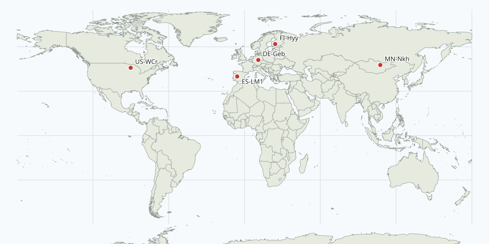
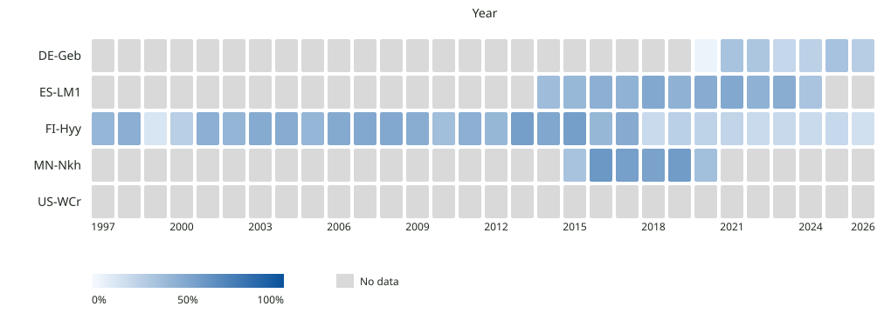
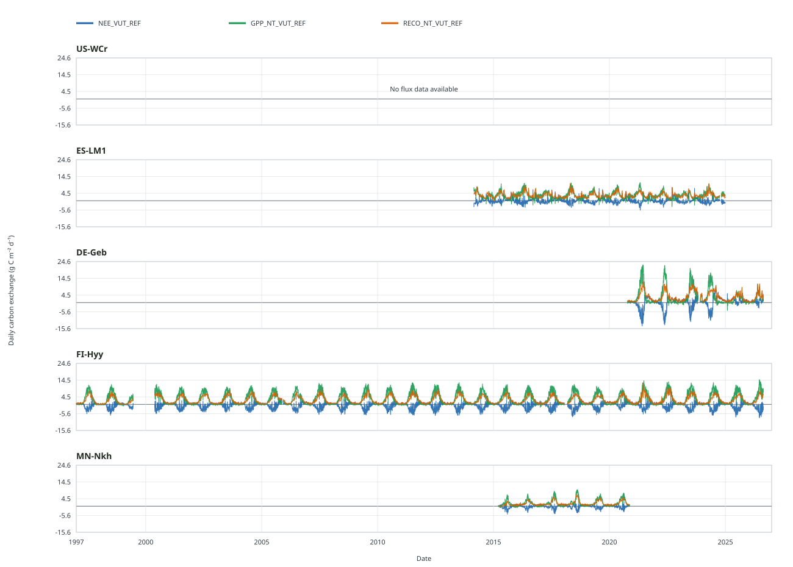
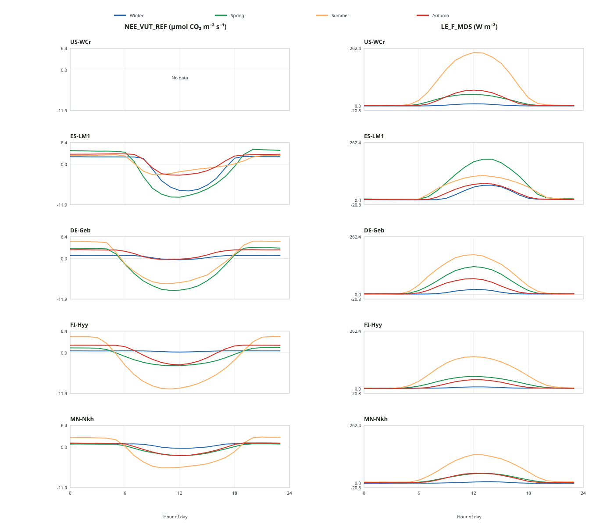

This report assembles the tables, figures, and summaries generated by
[`scripts/c1.py`](../scripts/c1.py). The tower data are downloaded with
[`scripts/get_my_towers.py`](../scripts/get_my_towers.py); rerun `c1.py` after
updating the inputs to refresh the report outputs.

```{python}
#| echo: false
import csv
import re
from collections import OrderedDict
from html import escape
from pathlib import Path

from IPython.display import HTML, Markdown, SVG, display

project_root = next(
    (
        path
        for path in (Path.cwd().resolve(), *Path.cwd().resolve().parents)
        if (path / "scripts/c1.csv").is_file()
    ),
    None,
)
if project_root is None:
    raise FileNotFoundError("Could not locate scripts/c1.csv from the report directory.")

scripts_dir = project_root / "scripts"
required_outputs = (
    "c1.csv",
    "world_map.svg",
    "heatmap.svg",
    "site_statistics.csv",
    "c3.md",
    "daily_flux.svg",
    "diurnal_cycles.svg",
    "c4.md",
    "c6.md",
    "c6_citations.md",
)
missing_outputs = [name for name in required_outputs if not (scripts_dir / name).is_file()]
if missing_outputs:
    raise FileNotFoundError(
        "Missing generated report files in scripts: "
        + ", ".join(missing_outputs)
        + ". Run scripts/c1.py to generate them."
    )


def render_table(headers, rows):
    head = "".join(f"<th>{escape(str(value))}</th>" for value in headers)
    body = "".join(
        "<tr>" + "".join(f"<td>{escape(str(value))}</td>" for value in row) + "</tr>"
        for row in rows
    )
    return (
        '<div class="report-table-wrap"><table class="report-table">'
        f"<thead><tr>{head}</tr></thead><tbody>{body}</tbody></table></div>"
    )


with (scripts_dir / "c1.csv").open(encoding="utf-8", newline="") as csv_file:
    overview_reader = csv.reader(csv_file)
    overview_headers = next(overview_reader)
    overview_rows = list(overview_reader)

display(HTML(render_table(overview_headers, overview_rows)))

c3_content = (scripts_dir / "c3.md").read_text(encoding="utf-8")
coverage_summary = re.split(r"(?m)(?=^### )", c3_content, maxsplit=1)[0].strip()
site_notes = {
    site.strip(): note.strip()
    for site, note in re.findall(
        r"(?ms)^### ([^\n]+)\n\n(.*?)(?=^### |\Z)",
        c3_content,
    )
}

with (scripts_dir / "site_statistics.csv").open(
    encoding="utf-8", newline=""
) as csv_file:
    statistic_reader = csv.DictReader(csv_file)
    statistic_headers = [
        header for header in statistic_reader.fieldnames or []
        if header not in {"Site", "Statistic"}
    ]
    statistic_rows = list(statistic_reader)

statistics_by_site = OrderedDict()
for row in statistic_rows:
    statistics_by_site.setdefault(row["Site"], []).append(row)
```

<style>
.report-table-wrap { overflow-x: auto; margin: 0.75rem 0 1.5rem; }
.report-table { border-collapse: collapse; width: 100%; }
.report-table th, .report-table td {
  border: 1px solid #d5dbe0;
  padding: 0.4rem 0.55rem;
  text-align: left;
  vertical-align: top;
}
.report-table th { background: #f1f4f6; }
</style>

## C1. Site overview

Site metadata and product citations are taken from the FLUXNET snapshot used by
the generator.



## C2. Data coverage

The heat map shows, for each site and year, the share of half hours with
`NEE_VUT_REF_QC == 0`. Gray cells indicate years outside a site's record or a
missing QC column in its file.



```{python}
#| echo: false
display(Markdown(coverage_summary))
```

## C3. Summary statistics

The tables summarize the half-hourly records. For `P_F`, the mean is the mean
annual precipitation total; its minimum and maximum are half-hourly values.
Missing percentages use all half hours in each site's file. Variables absent
from a file are shown as 100% missing.

```{python}
#| echo: false
for site_id, rows in statistics_by_site.items():
    display(Markdown(f"### {site_id}"))
    if site_notes.get(site_id):
        display(Markdown(site_notes[site_id]))
    table_rows = [
        [row["Statistic"], *(row[header] for header in statistic_headers)]
        for row in rows
    ]
    display(
        HTML(
            render_table(
                ["Statistic", *statistic_headers],
                table_rows,
            )
        )
    )
```

## C4. Time series

Daily values are the mean of the available half-hourly records for each
calendar day, multiplied by 1.0378 to convert to g C m⁻² d⁻¹. The panels share
one y-axis scale; gaps remain where the half-hourly variables are missing.



```{python}
#| echo: false
display(Markdown((scripts_dir / "c4.md").read_text(encoding="utf-8")))
```

## C5. Diurnal cycles

The x-axis is local standard time (no daylight-saving shift), grouped by hour
0–23. Meteorological seasons are reversed for sites south of the equator.



## C6. Your reading

### Energy balance

The fit and scatter use only half hours where both H and LE have QC flag 0 and
all four energy variables are present. The fit uses every qualifying row; the
displayed scatter is thinned to at most 20,000 points for readability.

```{python}
#| echo: false
energy_figure = scripts_dir / "energy_balance.svg"
if energy_figure.is_file():
    display(SVG(filename=str(energy_figure)))
else:
    display(
        Markdown(
            "The energy-balance figure will appear here after "
            "`scripts/c1.py` has been run with the tower data."
        )
    )
display(Markdown((scripts_dir / "c6.md").read_text(encoding="utf-8")))
```

### Data and citation

The site-product citations below come from the FLUXNET snapshot used to build
the summary.

```{python}
#| echo: false
display(Markdown((scripts_dir / "c6_citations.md").read_text(encoding="utf-8")))
```

Pastorello et al. (2020), *The FLUXNET2015 dataset and the ONEFlux processing
pipeline for eddy covariance data*, *Scientific Data* 7, 225.
[https://doi.org/10.1038/s41597-020-0534-3](https://doi.org/10.1038/s41597-020-0534-3).

> FLUXNET data products were produced and harmonized by eddy covariance regional
> networks and data processing centers, including AmeriFlux, ChinaFlux, European
> Fluxes Database, ICOS, JapanFlux, KoFlux, OzFlux, SAEON, and TERN. These
> products also include a modified version of ERA5 hourly data provided by the
> Copernicus Climate Change Service.
